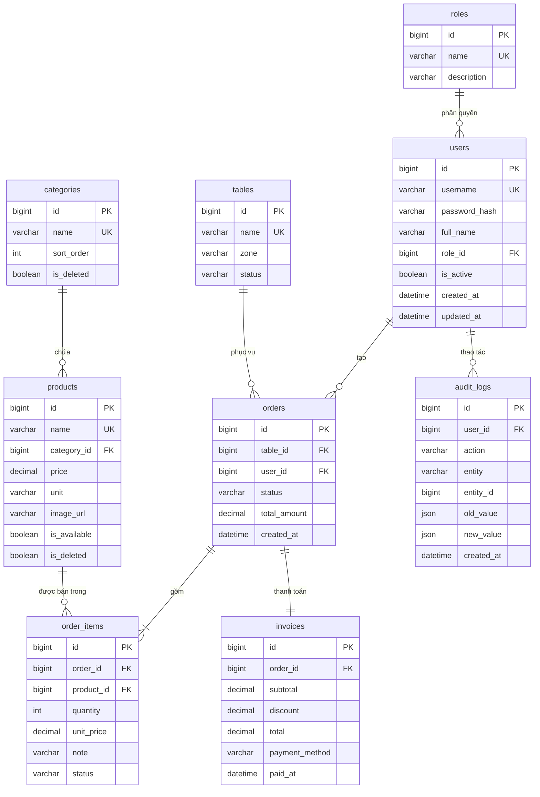

# ERD & từ điển dữ liệu

> **Trạng thái:** 🟡 KHUNG — B điền và chốt trước cổng **G2** (cuối tuần 2).
> Quy ước đặt tên, kiểu dữ liệu, ràng buộc: xem `WORKFLOW.md` **mục 8**.
> DDL thật nằm ở `db/schema.sql` — file này là bản thiết kế, `schema.sql` là bản thi hành;
> **hai file phải luôn khớp nhau**.

## 1. Sơ đồ

> Nếu công cụ bạn dùng không hiển thị Mermaid, xuất ảnh từ dbdiagram.io rồi lưu
> `docs/screenshots/db/erd-<YYYYMMDD>.png` và nhúng vào đây.

## 2. Từ điển dữ liệu

> Điền cho từng bảng. Ví dụ mẫu:

### `products` — món ăn / đồ uống

| Cột | Kiểu | Ràng buộc | Mô tả |
|---|---|---|---|
| `id` | BIGINT UNSIGNED | PK, AUTO_INCREMENT | |
| `name` | VARCHAR(150) | NOT NULL, UNIQUE | Tên món, duy nhất để tránh trùng |
| `category_id` | BIGINT UNSIGNED | NOT NULL, FK → `categories.id` | |
| `price` | DECIMAL(12,0) | NOT NULL, CHECK > 0 | VNĐ, **không phần lẻ** |
| `unit` | VARCHAR(20) | DEFAULT 'ly' | ly / cốc / phần |
| `image_url` | VARCHAR(255) | NULL | Đường dẫn tương đối tới `assets/` |
| `is_available` | BOOLEAN | DEFAULT 1 | Còn bán hay tạm hết |
| `is_deleted` | BOOLEAN | DEFAULT 0 | Xoá mềm |
| `created_at` | DATETIME | DEFAULT CURRENT_TIMESTAMP | |
| `updated_at` | DATETIME | ON UPDATE CURRENT_TIMESTAMP | |

### `<bảng tiếp theo>`

| Cột | Kiểu | Ràng buộc | Mô tả |
|---|---|---|---|
| | | | |

## 3. Enum & trạng thái

| Enum | Giá trị | Ghi chú |
|---|---|---|
| `orders.status` | `open` · `paid` · `cancelled` | |
| `order_items.status` | `pending` · `preparing` · `served` · `cancelled` | Trạng thái pha chế |
| `tables.status` | `free` · `occupied` · `reserved` | |
| `invoices.payment_method` | `cash` · `transfer` · `momo` | |
| `roles.name` | `admin` · `staff` · `barista` | |

## 4. Câu hỏi nghiệp vụ cần chốt

- [ ] Một hoá đơn có gộp nhiều bàn được không? (ảnh hưởng `orders.table_id`)
- [ ] Xoá mềm món thì hoá đơn cũ hiển thị thế nào? (giữ `unit_price` tại thời điểm bán)
- [ ] Có quản lý tồn nguyên liệu ở mốc 8 không? (nếu có: thêm `ingredients`, `recipes`)
- [ ] Ca làm việc (`shifts`) có cần cho báo cáo theo nhân viên không?
