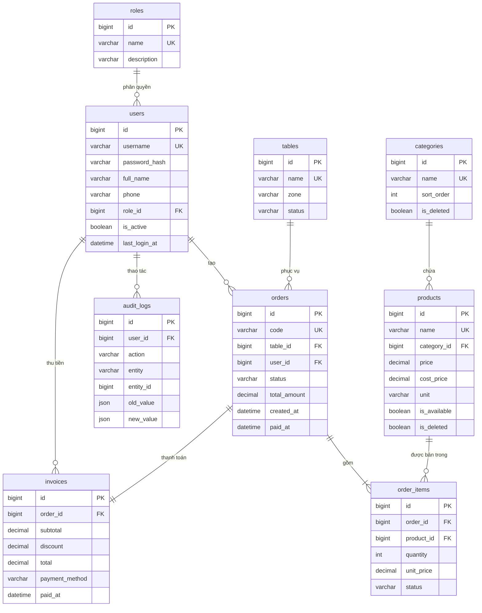

# ERD & từ điển dữ liệu

> **Trạng thái:** ✅ Đã chốt v1 (2026-11-04) — đủ để B dựng `db/schema.sql` và C dựng GUI.
> Thay đổi cấu trúc sau thời điểm này phải mở PR riêng + báo nhóm (WORKFLOW.md mục 8.1).
>
> Quy ước đặt tên, kiểu dữ liệu, ràng buộc: `WORKFLOW.md` **mục 8**.
> `db/schema.sql` là bản thi hành, file này là bản thiết kế — **hai file phải luôn khớp**.

## 1. Sơ đồ

> Không hiển thị được Mermaid? Xuất ảnh từ dbdiagram.io → lưu
> `docs/screenshots/db/erd-<YYYYMMDD>.png` → nhúng vào đây.

## 2. Quy ước dùng chung cho mọi bảng

| Quy ước | Giá trị |
|---|---|
| Engine / charset | `InnoDB` · `utf8mb4` · `utf8mb4_unicode_ci` |
| Khoá chính | `id BIGINT UNSIGNED AUTO_INCREMENT` |
| Thời gian | `created_at DATETIME DEFAULT CURRENT_TIMESTAMP`, `updated_at DATETIME DEFAULT CURRENT_TIMESTAMP ON UPDATE CURRENT_TIMESTAMP` |
| Tiền | `DECIMAL(12,0)` — VNĐ, **không phần lẻ**, **cấm** FLOAT/DOUBLE |
| Xoá | Xoá mềm bằng `is_deleted TINYINT(1)` với dữ liệu nghiệp vụ; **cấm** xoá cứng bảng có FK tới |
| Enum | `VARCHAR(20)` + validate ở tầng ứng dụng (không dùng `ENUM` để dễ mở rộng) |

## 3. Từ điển dữ liệu

### 3.1 `roles` — vai trò

| Cột | Kiểu | Ràng buộc | Mô tả |
|---|---|---|---|
| `id` | BIGINT UNSIGNED | PK | |
| `name` | VARCHAR(30) | NOT NULL, **UNIQUE** | `admin` · `staff` · `barista` |
| `description` | VARCHAR(255) | NULL | Mô tả quyền |
| `created_at` | DATETIME | DEFAULT now | |

> Seed sẵn 3 dòng. **Không cho phép tạo role mới trên UI** ở phiên bản này.

### 3.2 `users` — tài khoản nhân viên

| Cột | Kiểu | Ràng buộc | Mô tả |
|---|---|---|---|
| `id` | BIGINT UNSIGNED | PK | |
| `username` | VARCHAR(50) | NOT NULL, **UNIQUE** | Đăng nhập, không dấu, không khoảng trắng |
| `password_hash` | VARCHAR(255) | NOT NULL | **bcrypt cost ≥ 12** — cấm plaintext/MD5 |
| `full_name` | VARCHAR(100) | NOT NULL | Tên hiển thị |
| `phone` | VARCHAR(15) | NULL | |
| `role_id` | BIGINT UNSIGNED | NOT NULL, FK → `roles.id`, **ON DELETE RESTRICT** | |
| `is_active` | TINYINT(1) | NOT NULL DEFAULT 1 | Khoá tài khoản = set 0 |
| `last_login_at` | DATETIME | NULL | |
| `created_at` / `updated_at` | DATETIME | | |

**Index:** `idx_users_role_id`

### 3.3 `categories` — danh mục món

| Cột | Kiểu | Ràng buộc | Mô tả |
|---|---|---|---|
| `id` | BIGINT UNSIGNED | PK | |
| `name` | VARCHAR(100) | NOT NULL, **UNIQUE** | VD: Cà phê, Trà trái cây, Bánh ngọt |
| `description` | VARCHAR(255) | NULL | |
| `sort_order` | INT | NOT NULL DEFAULT 0 | Thứ tự hiển thị trên menu |
| `is_deleted` | TINYINT(1) | NOT NULL DEFAULT 0 | |
| `created_at` / `updated_at` | DATETIME | | |

### 3.4 `products` — món ăn / đồ uống

| Cột | Kiểu | Ràng buộc | Mô tả |
|---|---|---|---|
| `id` | BIGINT UNSIGNED | PK | |
| `name` | VARCHAR(150) | NOT NULL, **UNIQUE** | Duy nhất để chặn trùng món |
| `category_id` | BIGINT UNSIGNED | NOT NULL, FK → `categories.id`, **RESTRICT** | |
| `price` | DECIMAL(12,0) | NOT NULL, **CHECK (price > 0)** | Giá bán |
| `cost_price` | DECIMAL(12,0) | NULL, CHECK ≥ 0 | Giá vốn — phục vụ báo cáo lợi nhuận (mốc 8) |
| `unit` | VARCHAR(20) | NOT NULL DEFAULT 'ly' | ly / cốc / phần |
| `description` | VARCHAR(500) | NULL | |
| `image_url` | VARCHAR(255) | NULL | Đường dẫn tương đối trong `assets/` |
| `is_available` | TINYINT(1) | NOT NULL DEFAULT 1 | 0 = tạm hết |
| `is_deleted` | TINYINT(1) | NOT NULL DEFAULT 0 | |
| `created_at` / `updated_at` | DATETIME | | |

**Index:** `idx_products_category_id` · `idx_products_name (FULLTEXT)` · `idx_products_is_available`

### 3.5 `tables` — bàn

| Cột | Kiểu | Ràng buộc | Mô tả |
|---|---|---|---|
| `id` | BIGINT UNSIGNED | PK | |
| `name` | VARCHAR(30) | NOT NULL, **UNIQUE** | `B01`, `B02`, `Mang đi` |
| `zone` | VARCHAR(30) | NOT NULL DEFAULT 'Tầng 1' | Khu vực |
| `status` | VARCHAR(20) | NOT NULL DEFAULT 'free' | `free` · `occupied` · `reserved` |
| `created_at` / `updated_at` | DATETIME | | |

> Status là **cache** của trạng thái đơn đang mở. Nguồn chân lý vẫn là `orders`;
> service phải cập nhật lại khi mở/đóng đơn (không cho GUI tự set).

### 3.6 `orders` — đơn tại bàn

| Cột | Kiểu | Ràng buộc | Mô tả |
|---|---|---|---|
| `id` | BIGINT UNSIGNED | PK | |
| `code` | VARCHAR(20) | NOT NULL, **UNIQUE** | Mã hiển thị, VD `HD20261104-001` |
| `table_id` | BIGINT UNSIGNED | NULL, FK → `tables.id`, **RESTRICT** | NULL = mang đi |
| `user_id` | BIGINT UNSIGNED | NOT NULL, FK → `users.id`, RESTRICT | Nhân viên tạo đơn |
| `status` | VARCHAR(20) | NOT NULL DEFAULT 'open' | `open` · `paid` · `cancelled` |
| `note` | VARCHAR(255) | NULL | |
| `total_amount` | DECIMAL(12,0) | NOT NULL DEFAULT 0 | **Tính lại từ `order_items`** mỗi lần đổi |
| `created_at` | DATETIME | DEFAULT now | |
| `paid_at` | DATETIME | NULL | |
| `updated_at` | DATETIME | | |

**Index:** `idx_orders_status_created (status, created_at)` · `idx_orders_table_id` · `idx_orders_user_id`
**Quy tắc:** đơn `paid`/`cancelled` là **bất biến** — mọi thao tác sửa phải trả `409 ORDER_ALREADY_PAID`.

### 3.7 `order_items` — dòng món trong đơn

| Cột | Kiểu | Ràng buộc | Mô tả |
|---|---|---|---|
| `id` | BIGINT UNSIGNED | PK | |
| `order_id` | BIGINT UNSIGNED | NOT NULL, FK → `orders.id`, **ON DELETE CASCADE** | |
| `product_id` | BIGINT UNSIGNED | NOT NULL, FK → `products.id`, **RESTRICT** | |
| `quantity` | INT | NOT NULL, **CHECK (quantity > 0)** | |
| `unit_price` | DECIMAL(12,0) | NOT NULL | **Chụp lại giá tại thời điểm bán** |
| `note` | VARCHAR(255) | NULL | VD "ít đá", "không đường" |
| `status` | VARCHAR(20) | NOT NULL DEFAULT 'pending' | `pending` · `preparing` · `served` · `cancelled` |
| `created_at` | DATETIME | DEFAULT now | |

**Index:** `idx_order_items_order_id` · `idx_order_items_product_id` · `idx_order_items_status`

> ⚠️ **Không** đặt UNIQUE `(order_id, product_id)`: cùng một món có thể gọi 2 lần với
> ghi chú khác nhau. Việc gộp dòng hiển thị làm ở tầng GUI/service.

### 3.8 `invoices` — hoá đơn (1–1 với `orders`)

| Cột | Kiểu | Ràng buộc | Mô tả |
|---|---|---|---|
| `id` | BIGINT UNSIGNED | PK | |
| `order_id` | BIGINT UNSIGNED | NOT NULL, **UNIQUE**, FK → `orders.id`, RESTRICT | 1 đơn ↔ 1 hoá đơn |
| `subtotal` | DECIMAL(12,0) | NOT NULL | Tổng trước giảm giá |
| `discount` | DECIMAL(12,0) | NOT NULL DEFAULT 0, CHECK ≥ 0 | |
| `total` | DECIMAL(12,0) | NOT NULL, CHECK ≥ 0 | `subtotal - discount` |
| `payment_method` | VARCHAR(20) | NOT NULL DEFAULT 'cash' | `cash` · `transfer` · `momo` |
| `paid_at` | DATETIME | NOT NULL | |
| `created_by` | BIGINT UNSIGNED | NOT NULL, FK → `users.id`, RESTRICT | Thu ngân |
| `created_at` | DATETIME | DEFAULT now | |

**Index:** `idx_invoices_paid_at` (báo cáo doanh thu theo ngày chạy trên cột này)

### 3.9 `audit_logs` — nhật ký thao tác

| Cột | Kiểu | Ràng buộc | Mô tả |
|---|---|---|---|
| `id` | BIGINT UNSIGNED | PK | |
| `user_id` | BIGINT UNSIGNED | NULL, FK → `users.id`, **SET NULL** | NULL nếu user bị xoá |
| `action` | VARCHAR(50) | NOT NULL | `create` · `update` · `delete` · `login` · `checkout` |
| `entity` | VARCHAR(50) | NOT NULL | Tên bảng bị tác động |
| `entity_id` | BIGINT UNSIGNED | NULL | |
| `old_value` | JSON | NULL | Giá trị trước |
| `new_value` | JSON | NULL | Giá trị sau |
| `ip_address` | VARCHAR(45) | NULL | Ghi khi có (IPv4/IPv6) |
| `created_at` | DATETIME | DEFAULT now | |

**Index:** `idx_audit_logs_entity (entity, entity_id)` · `idx_audit_logs_created_at` · `idx_audit_logs_user_id`

> **Bắt buộc ghi log:** đổi giá, xoá món, sửa quyền, huỷ đơn, thanh toán, đăng nhập thất bại.
> Cấm ghi mật khẩu/token vào `old_value`/`new_value`.

## 4. Bất biến dữ liệu (service phải bảo đảm)

| # | Bất biến | Kiểm ở đâu |
|---|---|---|
| 1 | `orders.total_amount = Σ(order_items.quantity × unit_price)` với item chưa `cancelled` | `OrderService.recalc_total()` |
| 2 | `invoices.subtotal = orders.total_amount` tại thời điểm thanh toán | `CheckoutService` |
| 3 | `invoices.total = subtotal - discount`, không âm | DB `CHECK` + service |
| 4 | Đơn `paid` không sửa được item | Service trả `409` |
| 5 | `tables.status` phản ánh đúng số đơn `open` | Cập nhật trong cùng transaction |
| 6 | Không xoá cứng `products` đã có trong `order_items` | Chỉ xoá mềm |
| 7 | Mật khẩu luôn là bcrypt hash | `AuthService.hash_password()` |

## 5. Dữ liệu mẫu (`db/seed.sql`)

Yêu cầu: **idempotent** (`INSERT IGNORE` / `ON DUPLICATE KEY UPDATE`) để chạy lại không lỗi.

| Bảng | Số dòng | Ghi chú |
|---|---|---|
| `roles` | 3 | admin / staff / barista |
| `users` | 5 | 1 admin, 3 staff, 1 barista — mật khẩu mẫu `Cafe@123` (ghi rõ trong README, **đổi khi deploy**) |
| `categories` | 6 | Cà phê, Trà trái cây, Sinh tố, Bánh ngọt, Đồ ăn vặt, Topping |
| `products` | **50** | ≥ 8 món/danh mục chính, giá 15.000–65.000, có `cost_price` để tính lợi nhuận |
| `tables` | 12 | 8 bàn trong + 4 ngoài sân |
| `orders` + `order_items` | ~120 đơn | Trải trên **30 ngày** để biểu đồ doanh thu có dữ liệu đẹp ngay từ demo |
| `invoices` | ~110 | Phần lớn đơn `paid`, giữ vài đơn `open` để demo order |

> Dữ liệu 30 ngày là **bắt buộc** — nếu chỉ có 3 đơn, phần thống kê/báo cáo trông
> rỗng và mất điểm mốc 8 (GV sẽ thấy ngay lúc demo).

## 6. Câu hỏi nghiệp vụ — đã chốt

| Câu hỏi | Quyết định |
|---|---|
| Gộp nhiều bàn vào 1 hoá đơn? | **Chưa làm ở v1.** `table_id` 1-nhiều, mỗi đơn 1 bàn. Gộp bàn để mốc 8 (thêm `order_tables` hoặc `merged_into_id`) |
| Xoá mềm món thì hoá đơn cũ hiển thị? | Vẫn hiển thị nhờ `order_items.unit_price` chụp lại |
| Quản lý tồn nguyên liệu? | **Mốc 8** — thêm `ingredients`, `recipes`, `stock_movements`. v1 chưa có |
| Ca làm việc? | **Mốc 8** — thêm `shifts`. v1 báo cáo theo `user_id` |
| Một món gọi 2 lần với ghi chú khác? | Cho phép (không unique `order_id + product_id`) |
