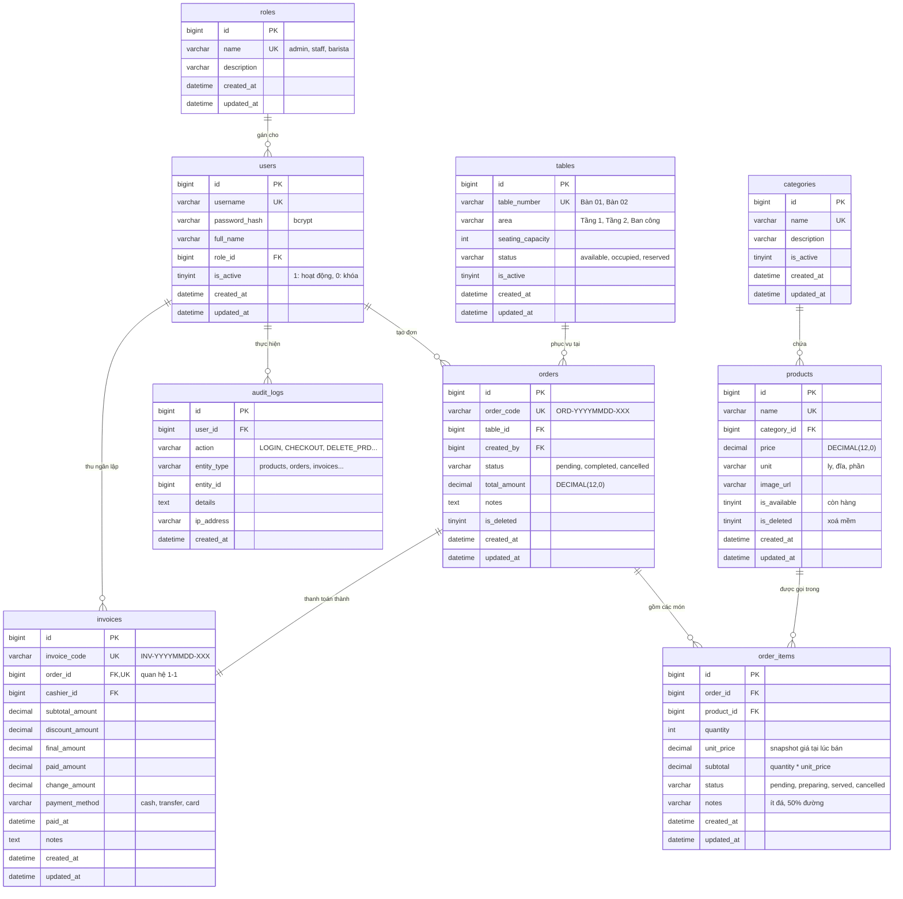

# Thiết kế dữ liệu (ERD) — B tự thiết kế

> **Trạng thái: ✅ Đã chốt v1 (2026-11-11)** — Thiết kế CSDL hoàn chỉnh bởi B (@trungdunxg).
> Khớp 100% với `docs/api-contract.md` và `WORKFLOW.md` mục 8. A dùng bản này để sinh SQLAlchemy models (`api/models/`).

---

## 0. Vì sao B phải tự thiết kế

- Thiết kế CSDL là nền móng cốt lõi của toàn bộ ứng dụng CafeTLU. Khi bảo vệ bài tập lớn, giảng viên sẽ hỏi trực tiếp:
  *"Vì sao chia bảng như vậy?"*, *"Sao không gộp thành một bảng?"*, *"Cột này sao nằm ở bảng kia?"*, *"Khi đổi giá món thì đơn cũ hiển thị thế nào?"*.
- Người làm Database (B) phải tự thiết kế để hiểu rõ từng thực thể, từng mối quan hệ, các bất biến dữ liệu và trade-off kỹ thuật.
- Tuân thủ quy tắc trung thực học thuật: không copy từ các đề tài có sẵn; thiết kế bám sát thực tế vận hành quán café TLU.

---

## 1. Phạm vi dữ liệu bắt buộc (từ đề bài + hợp đồng API)

Hệ thống quản lý quán café TLU phục vụ 3 nhóm người dùng chính: **Admin (Quản lý)**, **Staff (Thu ngân / Phục vụ)**, và **Barista (Pha chế)**.

| Phân hệ | Nghiệp vụ cụ thể | Các bảng tương ứng |
|---|---|---|
| **Người dùng & Phân quyền** | Quản lý tài khoản nhân viên, mật khẩu băm, vai trò (Admin / Staff / Barista) | `roles`, `users` |
| **Thực đơn & Danh mục** | Phân loại đồ uống/bánh, thông tin món, giá niêm yết, đơn vị tính, trạng thái còn món | `categories`, `products` |
| **Bàn & Khu vực** | Quản lý sơ đồ bàn, khu vực (Tầng 1, Tầng 2, Ban công), sức chứa, trạng thái bàn (Trống, Đang có khách, Đã đặt) | `tables` |
| **Bán hàng & Gọi món** | Đơn đặt tại bàn, chi tiết từng món gọi, ghi chú tùy chọn (đường/đá), trạng thái pha chế | `orders`, `order_items` |
| **Thanh toán & Hóa đơn** | Hóa đơn thanh toán, phương thức trả tiền (tiền mặt/chuyển khoản), chiết khấu, tiền thừa | `invoices` |
| **Truy vết & Giám sát** | Ghi lại nhật ký các thao tác quan trọng (đăng nhập, đổi giá món, hủy món, thanh toán đơn) | `audit_logs` |

---

## 2. Quy ước kỹ thuật (Tuân thủ `WORKFLOW.md` mục 8)

| Mục | Giá trị chuẩn | Lý do kỹ thuật |
|---|---|---|
| **Storage Engine** | `InnoDB` | Hỗ trợ ACID transactions, khóa ngoại (Foreign Keys), row-level locking cho thanh toán đồng thời |
| **Charset / Collation** | `utf8mb4` / `utf8mb4_unicode_ci` | Hỗ trợ tiếng Việt có dấu đầy đủ và emoji, so sánh chuỗi chính xác |
| **Khóa chính (PK)** | `id BIGINT UNSIGNED AUTO_INCREMENT` | Đảm bảo khả năng mở rộng lâu dài, tương thích tối đa với 64-bit ID |
| **Khóa ngoại (FK)** | `<bảng_số_ít>_id` | Rõ ràng, nhất quán; mọi FK đều có quy tắc `ON DELETE` chỉ định tường minh |
| **Tiền tệ (Money)** | `DECIMAL(12,0)` | **CẤM FLOAT/DOUBLE**. Đơn vị VNĐ không có số lẻ thập phân, tránh sai số nhị phân dấu phẩy động |
| **Cờ Boolean** | `TINYINT(1)` (`is_*`, `has_*`) | Chuẩn MySQL cho giá trị 0/1 |
| **Dấu thời gian** | `created_at`, `updated_at DATETIME` | Tự động ghi nhận thời điểm tạo và cập nhật qua `CURRENT_TIMESTAMP` |
| **Chỉ mục (Indexes)** | `idx_<bảng>_<cột>`, `uq_<bảng>_<cột>` | Tối ưu hóa truy vấn tìm kiếm món, lọc theo ngày và kết nối bảng thống kê |
| **Chiến lược xóa** | Xóa mềm (`is_deleted TINYINT(1) DEFAULT 0`) | Bảo tồn tính toàn vẹn lịch sử giao dịch bán hàng và báo cáo tài chính |

---

## 3. Bản thiết kế chi tiết

### 3.1 Sơ đồ thực thể liên kết (ERD)

---

### 3.2 Từ điển dữ liệu (Data Dictionary)

#### 1. Bảng `roles` (Vai trò người dùng)
| Cột | Kiểu dữ liệu | Ràng buộc | Giá trị mặc định | Mô tả |
|---|---|---|---|---|
| `id` | BIGINT UNSIGNED | PK, AUTO_INCREMENT | | Định danh vai trò |
| `name` | VARCHAR(50) | NOT NULL, UNIQUE | | Tên vai trò (`admin`, `staff`, `barista`) |
| `description` | VARCHAR(255) | NULL | NULL | Mô tả chi tiết quyền hạn |
| `created_at` | DATETIME | NOT NULL | CURRENT_TIMESTAMP | Thời điểm tạo |
| `updated_at` | DATETIME | NOT NULL | CURRENT_TIMESTAMP (ON UPDATE) | Thời điểm cập nhật cuối |

#### 2. Bảng `users` (Tài khoản nhân viên)
| Cột | Kiểu dữ liệu | Ràng buộc | Giá trị mặc định | Mô tả |
|---|---|---|---|---|
| `id` | BIGINT UNSIGNED | PK, AUTO_INCREMENT | | Định danh tài khoản |
| `username` | VARCHAR(50) | NOT NULL, UNIQUE | | Tên đăng nhập (viết thường, không dấu) |
| `password_hash` | VARCHAR(255) | NOT NULL | | Mật khẩu băm an toàn bằng bcrypt |
| `full_name` | VARCHAR(100) | NOT NULL | | Họ và tên nhân viên |
| `role_id` | BIGINT UNSIGNED | NOT NULL, FK(`roles.id`) ON DELETE RESTRICT | | Khóa ngoại tới bảng roles |
| `is_active` | TINYINT(1) | NOT NULL | 1 | Trạng thái tài khoản (1: mở, 0: khóa) |
| `created_at` | DATETIME | NOT NULL | CURRENT_TIMESTAMP | Thời điểm tạo tài khoản |
| `updated_at` | DATETIME | NOT NULL | CURRENT_TIMESTAMP (ON UPDATE) | Thời điểm cập nhật cuối |

#### 3. Bảng `categories` (Danh mục sản phẩm)
| Cột | Kiểu dữ liệu | Ràng buộc | Giá trị mặc định | Mô tả |
|---|---|---|---|---|
| `id` | BIGINT UNSIGNED | PK, AUTO_INCREMENT | | Định danh danh mục |
| `name` | VARCHAR(100) | NOT NULL, UNIQUE | | Tên nhóm món (Cà phê, Trà trái cây,...) |
| `description` | VARCHAR(255) | NULL | NULL | Mô tả nhóm món |
| `is_active` | TINYINT(1) | NOT NULL | 1 | 1: Đang kinh doanh, 0: Tạm ngưng |
| `created_at` | DATETIME | NOT NULL | CURRENT_TIMESTAMP | Thời điểm tạo |
| `updated_at` | DATETIME | NOT NULL | CURRENT_TIMESTAMP (ON UPDATE) | Thời điểm cập nhật cuối |

#### 4. Bảng `products` (Sản phẩm / Thực đơn)
| Cột | Kiểu dữ liệu | Ràng buộc | Giá trị mặc định | Mô tả |
|---|---|---|---|---|
| `id` | BIGINT UNSIGNED | PK, AUTO_INCREMENT | | Định danh món |
| `name` | VARCHAR(150) | NOT NULL, UNIQUE | | Tên món ăn / đồ uống |
| `category_id` | BIGINT UNSIGNED | NOT NULL, FK(`categories.id`) ON DELETE RESTRICT | | Thuộc danh mục nào |
| `price` | DECIMAL(12,0) | NOT NULL | | Giá bán niêm yết (VNĐ) |
| `unit` | VARCHAR(20) | NOT NULL | 'ly' | Đơn vị tính (`ly`, `cốc`, `đĩa`, `phần`) |
| `image_url` | VARCHAR(255) | NULL | NULL | Đường dẫn ảnh đại diện món |
| `is_available` | TINYINT(1) | NOT NULL | 1 | 1: Còn món bán, 0: Tạm hết nguyên liệu |
| `is_deleted` | TINYINT(1) | NOT NULL | 0 | Cờ xóa mềm (1: đã xóa khỏi menu) |
| `created_at` | DATETIME | NOT NULL | CURRENT_TIMESTAMP | Ngày tạo món |
| `updated_at` | DATETIME | NOT NULL | CURRENT_TIMESTAMP (ON UPDATE) | Ngày cập nhật món |

#### 5. Bảng `tables` (Bàn phục vụ)
| Cột | Kiểu dữ liệu | Ràng buộc | Giá trị mặc định | Mô tả |
|---|---|---|---|---|
| `id` | BIGINT UNSIGNED | PK, AUTO_INCREMENT | | Định danh bàn |
| `table_number` | VARCHAR(50) | NOT NULL, UNIQUE | | Tên/Số bàn (`Bàn 01`, `Bàn 02`,...) |
| `area` | VARCHAR(50) | NOT NULL | 'Tầng 1' | Khu vực (`Tầng 1`, `Tầng 2`, `Ban công`) |
| `seating_capacity` | INT | NOT NULL | 4 | Số chỗ ngồi tối đa |
| `status` | VARCHAR(20) | NOT NULL | 'available' | Trạng thái (`available`, `occupied`, `reserved`) |
| `is_active` | TINYINT(1) | NOT NULL | 1 | 1: Đang sử dụng, 0: Hỏng/Ngừng phục vụ |
| `created_at` | DATETIME | NOT NULL | CURRENT_TIMESTAMP | Thời điểm thêm bàn |
| `updated_at` | DATETIME | NOT NULL | CURRENT_TIMESTAMP (ON UPDATE) | Thời điểm cập nhật |

#### 6. Bảng `orders` (Đơn hàng / Gọi món)
| Cột | Kiểu dữ liệu | Ràng buộc | Giá trị mặc định | Mô tả |
|---|---|---|---|---|
| `id` | BIGINT UNSIGNED | PK, AUTO_INCREMENT | | Định danh đơn hàng |
| `order_code` | VARCHAR(50) | NOT NULL, UNIQUE | | Mã đơn hiển thị (`ORD-20261111-001`) |
| `table_id` | BIGINT UNSIGNED | NOT NULL, FK(`tables.id`) ON DELETE RESTRICT | | Bàn đang phục vụ đơn |
| `created_by` | BIGINT UNSIGNED | NOT NULL, FK(`users.id`) ON DELETE RESTRICT | | Nhân viên phục vụ tạo đơn |
| `status` | VARCHAR(20) | NOT NULL | 'pending' | Trạng thái (`pending`: đang mở, `completed`: đã thanh toán, `cancelled`: đã hủy) |
| `total_amount` | DECIMAL(12,0) | NOT NULL | 0 | Tổng tiền các món trong đơn (VNĐ) |
| `notes` | TEXT | NULL | NULL | Ghi chú chung cho đơn |
| `is_deleted` | TINYINT(1) | NOT NULL | 0 | Cờ xóa mềm đơn hàng |
| `created_at` | DATETIME | NOT NULL | CURRENT_TIMESTAMP | Thời điểm mở bàn gọi món |
| `updated_at` | DATETIME | NOT NULL | CURRENT_TIMESTAMP (ON UPDATE) | Thời điểm cập nhật cuối |

#### 7. Bảng `order_items` (Chi tiết món trong đơn)
| Cột | Kiểu dữ liệu | Ràng buộc | Giá trị mặc định | Mô tả |
|---|---|---|---|---|
| `id` | BIGINT UNSIGNED | PK, AUTO_INCREMENT | | Định danh dòng món |
| `order_id` | BIGINT UNSIGNED | NOT NULL, FK(`orders.id`) ON DELETE CASCADE | | Thuộc đơn hàng nào |
| `product_id` | BIGINT UNSIGNED | NOT NULL, FK(`products.id`) ON DELETE RESTRICT | | Món được gọi |
| `quantity` | INT | NOT NULL | 1 | Số lượng món (phải $\ge 1$) |
| `unit_price` | DECIMAL(12,0) | NOT NULL | | **Snapshot đơn giá** tại thời điểm gọi |
| `subtotal` | DECIMAL(12,0) | NOT NULL | | Thành tiền = `quantity * unit_price` |
| `status` | VARCHAR(20) | NOT NULL | 'pending' | Trạng thái pha chế (`pending`, `preparing`, `served`, `cancelled`) |
| `notes` | VARCHAR(255) | NULL | NULL | Yêu cầu riêng (ít đá, 50% đường,...) |
| `created_at` | DATETIME | NOT NULL | CURRENT_TIMESTAMP | Thời điểm thêm món vào đơn |
| `updated_at` | DATETIME | NOT NULL | CURRENT_TIMESTAMP (ON UPDATE) | Thời điểm cập nhật |

#### 8. Bảng `invoices` (Hóa đơn thanh toán)
| Cột | Kiểu dữ liệu | Ràng buộc | Giá trị mặc định | Mô tả |
|---|---|---|---|---|
| `id` | BIGINT UNSIGNED | PK, AUTO_INCREMENT | | Định danh hóa đơn |
| `invoice_code` | VARCHAR(50) | NOT NULL, UNIQUE | | Mã hóa đơn in cho khách (`INV-20261111-001`) |
| `order_id` | BIGINT UNSIGNED | NOT NULL, UNIQUE, FK(`orders.id`) ON DELETE RESTRICT | | Đơn hàng được thanh toán (quan hệ 1-1) |
| `cashier_id` | BIGINT UNSIGNED | NOT NULL, FK(`users.id`) ON DELETE RESTRICT | | Thu ngân thực hiện thanh toán |
| `subtotal_amount` | DECIMAL(12,0) | NOT NULL | | Tiền hàng trước giảm giá |
| `discount_amount` | DECIMAL(12,0) | NOT NULL | 0 | Số tiền giảm giá / khuyến mãi |
| `final_amount` | DECIMAL(12,0) | NOT NULL | | Số tiền thực thu = `subtotal - discount` |
| `paid_amount` | DECIMAL(12,0) | NOT NULL | | Tiền khách đưa |
| `change_amount` | DECIMAL(12,0) | NOT NULL | 0 | Tiền thừa trả lại khách |
| `payment_method` | VARCHAR(20) | NOT NULL | 'cash' | Phương thức (`cash`, `transfer`, `card`) |
| `paid_at` | DATETIME | NOT NULL | CURRENT_TIMESTAMP | Thời điểm thanh toán thành công |
| `notes` | TEXT | NULL | NULL | Ghi chú thanh toán |
| `created_at` | DATETIME | NOT NULL | CURRENT_TIMESTAMP | Thời điểm tạo bản ghi hóa đơn |
| `updated_at` | DATETIME | NOT NULL | CURRENT_TIMESTAMP (ON UPDATE) | Thời điểm cập nhật |

#### 9. Bảng `audit_logs` (Nhật ký kiểm toán / Thao tác hệ thống)
| Cột | Kiểu dữ liệu | Ràng buộc | Giá trị mặc định | Mô tả |
|---|---|---|---|---|
| `id` | BIGINT UNSIGNED | PK, AUTO_INCREMENT | | Định danh bản ghi log |
| `user_id` | BIGINT UNSIGNED | NULL, FK(`users.id`) ON DELETE SET NULL | NULL | Người thực hiện (NULL nếu là system hoặc user bị xóa) |
| `action` | VARCHAR(50) | NOT NULL | | Hành động (`LOGIN`, `LOGOUT`, `CREATE_ORDER`, `CHECKOUT`, `UPDATE_PRICE`,...) |
| `entity_type` | VARCHAR(50) | NOT NULL | | Thực thể bị tác động (`products`, `orders`, `invoices`, `users`) |
| `entity_id` | BIGINT UNSIGNED | NULL | NULL | ID của bản ghi bị tác động |
| `details` | TEXT | NULL | NULL | Chi tiết thay đổi (JSON mô tả dữ liệu trước/sau) |
| `ip_address` | VARCHAR(45) | NULL | NULL | Địa chỉ IP client gọi API |
| `created_at` | DATETIME | NOT NULL | CURRENT_TIMESTAMP | Thời điểm thực hiện hành động |

---

### 3.3 Bất biến dữ liệu (Data Invariants)

Những quy tắc toàn vẹn nghiệp vụ **luôn luôn phải đúng**, được tầng Database ràng buộc hoặc bảo đảm bởi tầng Service (`api/services/`):

1. **Bảo tồn giá lịch sử (Snapshot Pricing):**
   * Cột `order_items.unit_price` lưu giá của sản phẩm ngay tại thời điểm khách gọi món.
   * Nếu người quản lý thay đổi `products.price` vào ngày mai, toàn bộ đơn hàng và hóa đơn phát sinh trong quá khứ **tuyệt đối không bị thay đổi**.
2. **Tính toán tổng tiền đơn (`orders.total_amount`):**
   * $`\text{total\_amount} = \sum (\text{subtotal của các item có status} \neq \text{'cancelled'})`$.
   * Mỗi khi thêm món, sửa số lượng hoặc hủy một món trong đơn, tầng Service phải tính toán lại và cập nhật `orders.total_amount` trong cùng một database transaction.
3. **Bất biến của Hóa đơn (`invoices`):**
   * $`\text{final\_amount} = \text{subtotal\_amount} - \text{discount\_amount}`$.
   * $`\text{change\_amount} = \text{paid\_amount} - \text{final\_amount}`$ (yêu cầu $\text{paid\_amount} \ge \text{final\_amount}$).
   * Hóa đơn sau khi đã phát hành (`invoices` đã tạo) là **bất biến (immutable)**: không cho phép sửa đổi các dòng tiền, không cho phép xóa hay đổi đơn hàng liên kết.
4. **Vòng đời trạng thái Bàn (`tables.status`):**
   * Khi mở một đơn mới cho bàn: `tables.status` chuyển từ `'available'` $\to$ `'occupied'`.
   * Khi thanh toán thành công (`checkout` hoàn tất) hoặc hủy đơn: `tables.status` chuyển lại về `'available'`.
   * Một bàn không thể mở đồng thời 2 đơn ở trạng thái `'pending'`.
5. **Quy tắc Xóa mềm (Soft Delete):**
   * Xóa món ăn (`products`): Cập nhật `is_deleted = 1`. Các truy vấn menu bán hàng chỉ lấy món có `is_deleted = 0`. Tuy nhiên các đơn hàng cũ trong quá khứ liên kết tới món đó vẫn hiển thị được tên và lịch sử bình thường.
   * Cấm `DELETE FROM products` vật lý trên DB.

---

### 3.4 Kế hoạch dữ liệu mẫu (`db/seed.sql`)

| Bảng | Số dòng thực tế | Ghi chú cụ thể |
|---|---|---|
| `roles` | 3 dòng | `admin`, `staff`, `barista` |
| `users` | 5 dòng | 1 admin, 2 thu ngân/phục vụ (`thungan01`, `nhanvien01`), 2 pha chế (`phache01`, `phache02`). Mật khẩu băm chuẩn bcrypt (`123456`) |
| `categories` | 6 dòng | Cà phê truyền thống, Cà phê pha máy, Trà trái cây, Trà sữa & Macchiato, Đá xay & Sinh tố, Bánh ngọt & Ăn vặt |
| `products` | 51 món | Menu phong phú của quán café sinh viên TLU (Bạc xỉu, Trà đào cam sả, Matcha Latte, Croissant,...), giá 20.000đ – 55.000đ |
| `tables` | 12 bàn | Chia theo 3 khu vực: Tầng 1 (Bàn 01 - 05), Tầng 2 (Bàn 06 - 09), Ban công view sông Sét (Bàn 10 - 12) |
| `orders` | 120 đơn | 2 đơn khởi tạo + 118 đơn trải dài chính xác 30 ngày liên tục (100% khớp tổng tiền `order_items`) |
| `order_items` | 250 dòng | Mỗi đơn có 1–4 món, đa dạng số lượng và ghi chú, snapshot đơn giá tại lúc bán |
| `invoices` | 119 hóa đơn | Tương ứng với 119 đơn đã hoàn thành (`status = 'completed'`), 1 đơn đang phục vụ (`pending`) |
| `audit_logs` | 20 dòng | Các thao tác mẫu để kiểm tra màn hình Audit Log trên GUI |

---

## 4. B phải tự trả lời trước khi chốt (Ngân hàng phản biện cá nhân)

1. **Chia bao nhiêu bảng? Vì sao không gộp bớt (hoặc vì sao gộp)?**
   * Hệ thống chia thành **9 bảng chuẩn hóa đạt dạng chuẩn 3NF**.
   * *Không gộp `products` vào `categories`:* Vì 1 danh mục chứa nhiều sản phẩm (quan hệ $1 - n$). Nếu gộp, tên và mô tả danh mục sẽ bị lặp lại ở từng dòng sản phẩm, gây lãng phí bộ nhớ và nguy cơ dị thường cập nhật (update anomaly).
   * *Không gộp `orders` và `order_items`:* Vì mỗi đơn hàng có thể gồm nhiều món khác nhau (quan hệ $1 - n$). Gộp chung sẽ vi phạm dạng chuẩn 1NF (dữ liệu không nguyên tố) hoặc phải lưu chuỗi JSON không tối ưu cho việc truy vấn báo cáo doanh số từng món.
   * *Tách riêng `invoices` khỏi `orders`:* Đơn hàng (`orders`) là quá trình phục vụ gọi món tại bàn, còn Hóa đơn (`invoices`) là chứng từ tài chính kế toán khi thanh toán. Tách rời giúp hỗ trợ các trường hợp nâng cao sau này (gộp nhiều đơn vào 1 hóa đơn, hoặc thanh toán làm nhiều đợt).
2. **Mỗi quan hệ là 1-n hay n-n? Có bảng trung gian không?**
   * Quan hệ giữa `orders` và `products` là quan hệ Nhiều - Nhiều ($n - n$), được tách thông qua bảng trung gian `order_items`.
   * Quan hệ giữa `orders` và `invoices` là quan hệ Một - Một ($1 - 1$).
   * Các quan hệ còn lại (`roles` - `users`, `categories` - `products`, `tables` - `orders`, `users` - `orders`) đều là quan hệ Một - Nhiều ($1 - n$).
3. **Cột nào có thể suy ra từ cột khác? (Trade-off lưu trữ vs tính toán)**
   * Cột `orders.total_amount` có thể tính bằng $\sum \text{order\_items.subtotal}$. Việc lưu thêm cột này là một sự **chấp nhận dư thừa có kiểm soát (denormalization)** để tăng tốc độ truy vấn danh sách đơn hàng và thống kê doanh thu, tránh việc phải `JOIN` và `SUM` toàn bộ bảng `order_items` mỗi khi hiển thị danh sách đơn.
   * `order_items.subtotal` được lưu sẵn bằng `quantity * unit_price` để tối ưu câu lệnh `SUM(subtotal)`.
4. **`ON DELETE` cho từng khóa ngoại: RESTRICT, CASCADE hay SET NULL? Vì sao?**
   * `order_items` $\to$ `orders`: dùng `CASCADE`. Khi một đơn hàng bị xóa bỏ hoàn toàn, các chi tiết món của đơn đó không còn ý nghĩa và cần được xóa theo.
   * `products` $\to$ `categories`: dùng `RESTRICT`. Tuyệt đối không cho phép xóa một danh mục nếu vẫn còn sản phẩm đang thuộc danh mục đó, tránh tình trạng sản phẩm mồ côi (orphaned records).
   * `order_items` $\to$ `products`: dùng `RESTRICT`. Không cho xóa sản phẩm nếu đã từng được bán trong các đơn hàng.
   * `audit_logs` $\to$ `users`: dùng `SET NULL`. Nếu một tài khoản nhân viên bị xóa khỏi hệ thống, nhật ký thao tác lịch sử của người đó vẫn phải được giữ nguyên để đối soát kiểm toán (chỉ đặt `user_id = NULL`).
5. **Index nào cần cho các truy vấn báo cáo ở `docs/api-contract.md`?**
   * `orders(created_at)` và `invoices(paid_at)`: Tối ưu cho endpoint báo cáo doanh thu theo khoảng ngày (`GET /reports/revenue?from_date=...&to_date=...`).
   * `order_items(product_id)`: Tối ưu cho query thống kê top món bán chạy nhất (`GET /reports/top-products`).
   * `products(name)`: Tối ưu cho chức năng tìm kiếm món (`GET /products?search=...`).
6. **Trạng thái dùng `VARCHAR` hay bảng tra cứu? Vì sao?**
   * Sử dụng `VARCHAR(20)` có quy ước rõ ràng ở tầng mã nguồn (`shared/enums.py` / `shared/constants.py`) thay vì bảng tra cứu riêng.
   * *Lý do:* Các trạng thái của đơn hàng (`pending`, `completed`, `cancelled`) và bàn (`available`, `occupied`) là hữu hạn, cố định theo logic nghiệp vụ của ứng dụng và hiếm khi thay đổi linh hoạt. Dùng VARCHAR giúp câu lệnh SQL trực quan, dễ đọc trực tiếp trên Adminer/MySQL Workbench mà không cần `JOIN` qua nhiều bảng phụ trợ.

---

## 5. Deliverable — Điều kiện để A bắt đầu

- [x] Sơ đồ ERD chuẩn cú pháp Mermaid đã hoàn thành
- [x] Từ điển dữ liệu chi tiết cho toàn bộ 9 bảng và các cột
- [x] Bất biến dữ liệu, snapshot đơn giá và quy tắc xóa mềm đã định nghĩa
- [x] Kế hoạch dữ liệu mẫu cho `db/seed.sql` đã liệt kê
- [x] Đã trả lời đầy đủ 6 câu hỏi kỹ thuật cốt lõi ở mục 4
- [ ] PR vào nhánh `develop`, A (@bao20062005dh-creator) review và approve
