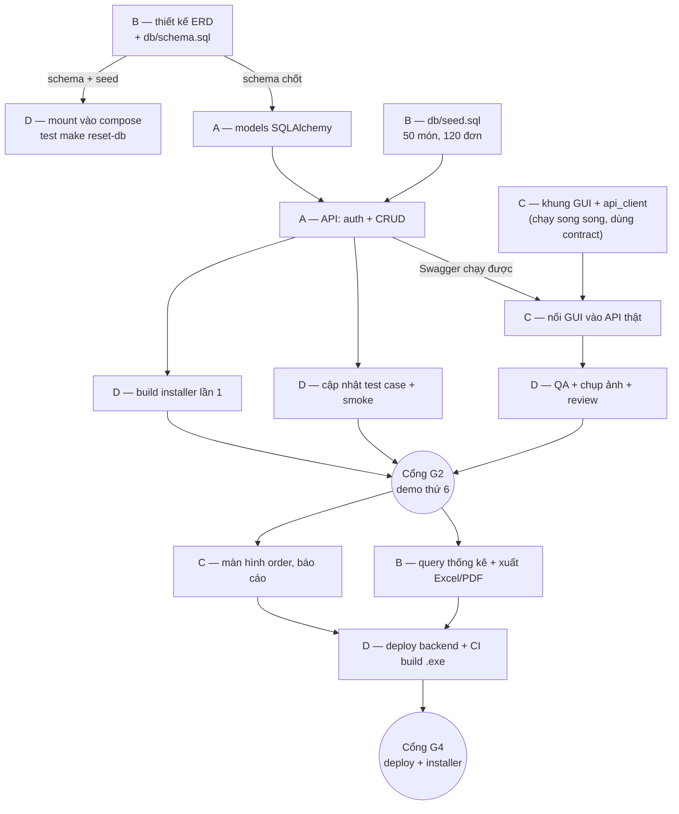

# Workflow bàn giao — ai làm gì, xong thì đến ai

> Trả lời một câu hỏi duy nhất: **"Tôi xong việc này rồi, giờ ai làm tiếp?"**
> Quy chuẩn đầy đủ (nhánh, commit, review, DoD): [`WORKFLOW.md`](../WORKFLOW.md).
> Tài liệu này chỉ nói về **dòng chảy công việc giữa 4 người**.

## 0. Bốn nguyên tắc bàn giao

1. **Mỗi hạng mục có đúng 1 người giữ bóng** tại một thời điểm. Không "cả hai cùng làm",
   không "đang để đó".
2. **Bàn giao bằng artifact, không bằng lời.** Phải có: nhánh đã push + PR + CI xanh +
   1–3 dòng ghi chú "cần gì ở người nhận". Nói miệng trong nhóm chat **không tính là bàn giao**.
3. **Không bàn giao "gần xong".** Bàn giao khi đã chạy được hoặc khi bị chặn thật sự (kèm mô tả lỗi).
4. **Người nhận phản hồi trong 24h** — nhận, hoặc nói rõ khi nào nhận. Im lặng là lỗi quy trình.

## 1. Sơ đồ tổng



## 2. Bảng bàn giao chính

| # | Từ | Sản phẩm bàn giao | Đến | Điều kiện "sẵn sàng nhận" |
|---|---|---|---|---|
| 1 | **B** | `db/schema.sql` + `db/seed.sql` | **A** | `make reset-db` chạy sạch 2 lần liên tiếp trên máy B |
| 2 | **B** | 2 dòng mount trong `docker-compose.yml` | **D** | D test `make reset-db` trên máy mình (không phải máy B) |
| 3 | **B** | Hàm trong `api/services/reports.py` | **A** | Có docstring + chạy được trên dữ liệu seed |
| 4 | **A** | Endpoint mới chạy trên Swagger | **C** | Có trong `docs/api-contract.md`, có test, CI xanh |
| 5 | **A** | Endpoint mới | **D** | Thêm dòng test case tương ứng |
| 6 | **C** | Màn hình + ảnh chụp | **D** | Ảnh ở `docs/screenshots/`, test case đã điền |
| 7 | **C** | Thiếu/sai API phát hiện khi nối | **A** | Ghi rõ endpoint, request, response mong đợi |
| 8 | **A + B + C** | App chạy end-to-end trên `develop` | **D** | `make up && make api && make gui` chạy được trên máy người khác |
| 9 | **D** | Installer + CI xanh | **Cả nhóm** | Cài được trên máy Windows sạch |
| 10 | **Bất kỳ** | Pull request | **Owner vùng** | CI xanh, `make check` xanh, đúng template |
| 11 | **Owner** | Review + merge | **Người viết** | Ghi rõ `[must]` / `[should]` / `[nit]` |

> **Owner vùng** (ai review cái gì): `api/` → A · `db/`, report → B · `gui/`, `assets/` → C ·
> `infra/`, `installer/`, `.github/`, `docs/` → D. Chi tiết: `WORKFLOW.md` mục 3.

## 3. Vòng đời một việc — ai giữ bóng ở từng bước

| Bước | Người giữ bóng | Làm gì | Bàn giao khi |
|---|---|---|---|
| 1 | Người tạo / **D** | Viết Issue đạt Definition of Ready, gán assignee + milestone | Issue ở cột `Ready` |
| 2 | **Assignee** | Tạo nhánh, code, `make check` | `make test` xanh + có test |
| 3 | **Assignee** | Push + mở PR theo template | PR mở, CI xanh, reviewer được gán |
| 4 | **Reviewer** (owner vùng) | Review theo checklist, trong 24h | Approve, hoặc comment `[must]` |
| 5 | **Assignee** | Sửa `[must]`, trả lời `[question]` | CI xanh trở lại |
| 6 | **Reviewer** | Squash merge, nhánh tự xoá | PR merged |
| 7 | **D** | Kiểm chứng trên `develop`, cập nhật test case, ảnh chụp | Issue → `Done` |

**Luật:** người viết **không tự merge** PR của mình (repo cũng chặn bằng branch protection).

## 4. "Xong thì đến ai" — cây quyết định

```
Xong schema / migration?      →  A (viết models)  +  D (test reset-db)
Xong endpoint?                →  C (nối GUI)      +  D (test case)
Xong màn hình?                →  D (QA, ảnh chụp) +  A nếu thiếu API
Xong query thống kê?          →  A (bọc endpoint) →  C (hiển thị)
App chạy end-to-end?          →  D (đóng gói installer)
Xong PR?                      →  owner vùng review
Bị chặn > 2 giờ?               →  người đang giữ blocker + D
Không rõ nghiệp vụ?           →  hỏi trong Issue (không tự đoán), tag D
```

## 5. Đang chờ người khác thì làm gì (đừng ngồi không)

| Đang chờ | A làm | B làm | C làm | D làm |
|---|---|---|---|---|
| **Chờ B có schema** | `shared/error_codes.py`, config, khung FastAPI + `/health` | *đang làm chính* | khung GUI + `api_client.py` (dùng contract) | `make doctor` mở rộng, Dockerfile |
| **Chờ A có API** | *đang làm chính* | seed 120 đơn, query thống kê | theme, `i18n.py`, mock data để dựng layout | build installer thử lần 1 |
| **Chờ C có màn hình** | test API, tối ưu query | test query thống kê | *đang làm chính* | test case, khung báo cáo |
| **Chờ D có installer** | review PR | viết chương báo cáo | chụp ảnh màn hình | *đang làm chính* |

**Chốt:** `docs/api-contract.md` đã có 23 endpoint → **C không phải chờ A** để bắt đầu.

## 6. SLA & escalation

| Việc | Hạn | Quá hạn thì |
|---|---|---|
| Review PR | 24h | Nhắn trong PR, D chuyển reviewer khác |
| Trả lời câu hỏi trong Issue | trong ngày | D nhắc trực tiếp |
| Báo khi bị chặn | 2h | — (im lặng là lỗi quy trình) |
| Cập nhật board | ngay khi đổi trạng thái | D rà board mỗi tối |
| Cứu scope | trễ ≥ 2 ngày | Nhóm họp **cắt tính năng phụ**, giữ luồng chính chạy được |

## 7. Theo giai đoạn: ai làm gì, xong bàn giao gì

> **Chi tiết theo từng cổng, giao theo thứ tự nào:** [`docs/plan.md`](plan.md).
> Điều kiện "xanh" của từng cổng nằm ở **`WORKFLOW.md` mục 16.3** — mục này chỉ nói **ai làm gì**
> trong mỗi giai đoạn, không định nghĩa lại cổng.

### G1 — Nền móng

| Người | Làm | Bàn giao |
|---|---|---|
| B | `db/schema.sql` | → A, D |
| A | khung `api/` + `/health` + config | → C |
| C | khung `gui/` + `theme.py` + `api_client.py` | → D |
| D | build installer thử lần 1, `make doctor` + MySQL | → cả nhóm |

**Cổng:** cả 4 máy chạy được bằng README, CI xanh, có 1 bản cài cài được.

### G2 — Lát cắt dọc

| Người | Làm | Bàn giao |
|---|---|---|
| B | `seed.sql` + 120 đơn 30 ngày | → A (test), D (demo data) |
| A | auth JWT + CRUD món | → C (nối), D (test case) |
| C | màn Đăng nhập + Danh sách món | → D (QA + ảnh) |
| D | QA smoke test, ảnh chụp | → cả nhóm |

**Cổng:** login + phân quyền + CRUD món chạy end-to-end trên máy người khác.

### G3–G6

| Giai đoạn | Trọng tâm | Bàn giao cuối |
|---|---|---|
| **G3** MVP | Order, hoá đơn, tìm kiếm, thống kê | D đóng gói installer cài được |
| **G4** Deploy | Docker + deploy backend, CI build `.exe` | URL công khai → cả nhóm test |
| **G5** QA | Test case pass ≥ 95%, báo cáo 80%, video | D biên tập báo cáo |
| **G6** Đóng băng | Trước hạn 3 ngày, chỉ hotfix | D nộp bài |

## 8. Bàn giao cuối kỳ (G6) — ai nộp gì

| Người | Nộp cho D | Hạn |
|---|---|---|
| A | Chương Backend + API + ảnh Swagger, sơ đồ kiến trúc | trước hạn 5 ngày |
| B | Chương CSDL + ERD + thống kê + ảnh biểu đồ | trước hạn 5 ngày |
| C | Chương GUI + ảnh từng màn hình + mô tả luồng | trước hạn 5 ngày |
| D | Biên tập báo cáo, video demo, đóng gói nộp | hạn nộp |

**Điều kiện nộp:** mỗi người thuyết trình được **toàn bộ** hệ thống trong 5 phút,
không chỉ phần mình (GV có thể hỏi bất kỳ phần nào).
