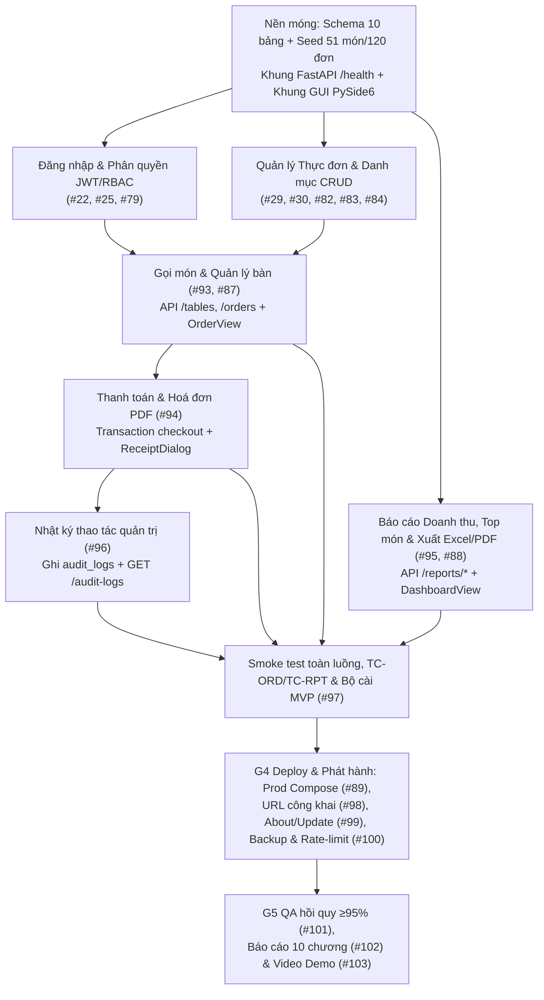

# Workflow thực hiện chức năng — từ Issue đến `develop`

> Trả lời một câu hỏi duy nhất: **"Một chức năng đi từ Issue vào `develop` thế nào?"**
> Quy chuẩn đầy đủ (kiến trúc, nhánh, commit, DoD): [`WORKFLOW.md`](../WORKFLOW.md).
> Từ 2026-11-18, nhóm áp dụng **ADR-014**: **gán thành viên theo chức năng cần làm**, **bỏ bắt buộc approve**, và **100% thay đổi qua Issue + Pull Request**.

## 0. Bốn nguyên tắc phối hợp

1. **Mỗi Issue chức năng có đúng 1 thành viên phụ trách chính** tại một thời điểm — được sửa trọn gói mọi tầng (`db/`, `api/`, `gui/`, `shared/`, `tests/`, `docs/`) trong phạm vi chức năng đó, giữ kiến trúc `gui → api → db`.
2. **Bàn giao bằng artifact, không bằng lời.** Phải có: Issue + nhánh đã push + PR (`Refs #<issue>`) + CI xanh + chứng cứ chạy thật.
3. **Không để nhánh treo dở.** Bị chặn **> 2 giờ** phải ghi rõ blocker ngay trong Issue và tag người liên quan cùng D (`@Haianh4705`).
4. **Cần đồng đội phối hợp → chốt ngay trong Issue**, không tự đoán hợp đồng API hoặc schema khi ảnh hưởng chức năng khác.

## 1. Luồng phụ thuộc các chức năng (G1 → G5)



## 2. Vòng đời một chức năng — ai giữ bóng ở từng bước

| Bước | Người giữ bóng | Làm gì | Hoàn tất khi |
|---|---|---|---|
| 1 | Người điều phối (**D**) hoặc bất kỳ ai đề xuất | Viết Issue chức năng đạt Definition of Ready, gán **1 assignee**, **milestone**, **nhãn tầng chạm tới** | Issue sẵn sàng để nhận |
| 2 | **Assignee** | Tạo nhánh từ `develop` mới nhất; đọc skill tương ứng các tầng chạm tới; code trọn gói `db/` → `api/` → `gui/` + viết test; chạy `make check` | `make lint && make test` xanh ở local |
| 3 | **Assignee** | Cập nhật `CHANGELOG.md` (nếu đổi hành vi), `docs/log/<vai>.md` (mục 2 + 3), ảnh chụp (nếu đổi/xong màn hình); push + mở PR với `Refs #<issue>` và 3 câu "Giải thích được" | PR mở theo template |
| 4 | GitHub Actions (`CI`) + **Assignee** | Chờ 2 check bắt buộc (`Lint & format`, `Test`) xanh; tự rà checklist ở mẫu PR (tag đồng đội góp ý nếu thay đổi phức tạp) | CI xanh, mọi comment đã resolve |
| 5 | **Assignee** (hoặc **D** hỗ trợ) | Bấm **Squash and merge** vào `develop` (không cần approve), xoá nhánh đã merge | PR merged vào `develop` |
| 6 | **Assignee** (hoặc **D**) | Kiểm chứng tiêu chí Issue chạy trên `develop`, dán link PR vào Issue rồi **đóng Issue** | Issue Closed, đạt DoD |

## 3. Cây quyết định nhanh

```
Muốn bắt đầu việc mới?             →  chạy `make next` hoặc xem milestone cổng trên GitHub
Issue chạm nhiều tầng (db/api/gui)? →  cùng 1 người làm trọn gói Issue đó, giữ kiến trúc gui → api → db
Cần thêm/đổi endpoint hợp đồng?     →  cập nhật docs/api-contract.md trong PR và báo nhóm
Cần thêm bảng/cột vào DB?           →  viết migration Alembic mới + cập nhật db/schema.sql + docs/erd.md
PR đã xanh CI và đủ checklist?      →  tác giả tự Squash & Merge → kiểm chứng develop → đóng Issue
Bị chặn > 2 giờ?                    →  ghi blocker trong Issue, tag người liên quan + D
```

## 4. Làm gì khi một Issue đang bị phụ thuộc?

Không ngồi chờ. Chọn một trong các việc độc lập sau:

- Nhận một Issue chức năng không bị chặn ở cùng cổng hoặc cổng tiếp theo (xem [`docs/plan.md`](plan.md)).
- Triển khai trước phần tầng dưới/tầng trên dựa theo hợp đồng đã chốt trong [`docs/api-contract.md`](api-contract.md) (kèm test đơn vị hoặc chế độ mock để kiểm tra).
- Bổ sung test hồi quy, dọn lỗi mở, viết nội dung chương tương ứng trong `report/` theo dữ liệu/code thật đã có.

## 5. Nhịp kiểm tra & xử lý trễ

| Hoạt động | Nhịp / Ngưỡng | Cách xử lý |
|---|---|---|
| Cập nhật tiến độ Issue | Khi nhận việc, mở PR hoặc gặp blocker | Ghi trực tiếp trên Issue / PR GitHub |
| Báo bị chặn (blocker) | Quá 2 giờ | Tag người liên quan + D trong Issue |
| Demo tích hợp & hỏi chéo | Thứ Sáu hằng tuần | Chạy thật trên `develop`, rà tiêu chí cổng và 3 câu bảo vệ |
| Cứu scope khi trễ | Trễ ≥ 2 ngày | D cùng nhóm cắt từ dưới lên theo bảng mục 9 trong `docs/plan.md` |

## 6. Theo giai đoạn — mục tiêu từng cổng

> Chi tiết danh sách Issue và thứ tự phụ thuộc nằm ở [`docs/plan.md`](plan.md). Tiêu chí xanh của từng cổng nằm ở `WORKFLOW.md` mục 16.3.

| Cổng | Trọng tâm chức năng | Đầu ra nghiệm thu |
|---|---|---|
| **G1 — Nền móng** | Hạ tầng Docker/MySQL, schema 10 bảng, 51 món mẫu, khung FastAPI `/health`, khung GUI, màn Đăng nhập, build thử `.exe` | Máy A và D `make doctor` xanh (C miễn riêng ở G1 theo ADR-015), CI xanh, Swagger mở, bộ cài chạy Windows sạch |
| **G2 — Lát cắt dọc** | Auth JWT + CRUD thực đơn & danh mục chạy end-to-end GUI ↔ API ↔ MySQL, khung báo cáo 10 chương | Login → tìm/thêm/sửa/xoá món trên máy khác, `staff` nhận 403, ≥ 12 endpoint có test |
| **G3 — MVP** | Bàn & Order tại bàn (`#93`), Checkout & in bill PDF (`#94`), Báo cáo & Excel/PDF (`#95`), Audit log (`#96`), Smoke test & installer MVP (`#97`) | Đủ 6 yêu cầu đề bài chạy end-to-end, bộ cài MVP cài được trên Windows sạch |
| **G4 — Deploy** | Compose prod + migration (`#89`), Deploy URL công khai & client trỏ URL (`#98`), About/Auto-update (`#99`), Backup & Rate-limit (`#100`), hardening (`#76`, `#80`, `#86`) | Backend có URL HTTPS công khai, tag `v*` build `.exe` và verify sạch trên Windows |
| **G5 — QA & Báo cáo** | Chạy hết `docs/test-cases.md` + bộ ảnh (`#101`), Hoàn thiện báo cáo 10 chương (`#102`), Quay video demo 3–5 phút & tập bảo vệ (`#103`) | ≥ 95% test case PASS, báo cáo ≥ 80%, đủ 4 file `docs/log/<vai>.md`, có video demo |
| **G6 — Đóng băng** | Trước hạn 3 ngày: đóng băng tính năng (chỉ `hotfix`), diễn tập demo trên máy khác, rà toàn bộ sổ bảo vệ | Sẵn sàng nộp source + `.exe` + báo cáo PDF + video |

## 7. Nhật ký & Bàn giao bảo vệ cuối kỳ

- **Mỗi Issue/PR hoàn thành:** tác giả tự thêm 1 dòng vào mục 2 + mục 3 trong file nhật ký cá nhân của mình ([`log/A.md`](log/A.md) · [`log/B.md`](log/B.md) · [`log/C.md`](log/C.md) · [`log/D.md`](log/D.md)) dù Issue đó chạm bất kỳ tầng nào.
- **Trước buổi bảo vệ (G6):** mỗi thành viên rà lại mục 4 (câu hỏi bảo vệ) trong file log của mình, nắm tổng quan toàn bộ luồng `gui → api → db` (mỗi người thuyết trình được toàn hệ thống trong 5 phút theo [`defense.md`](defense.md)).
