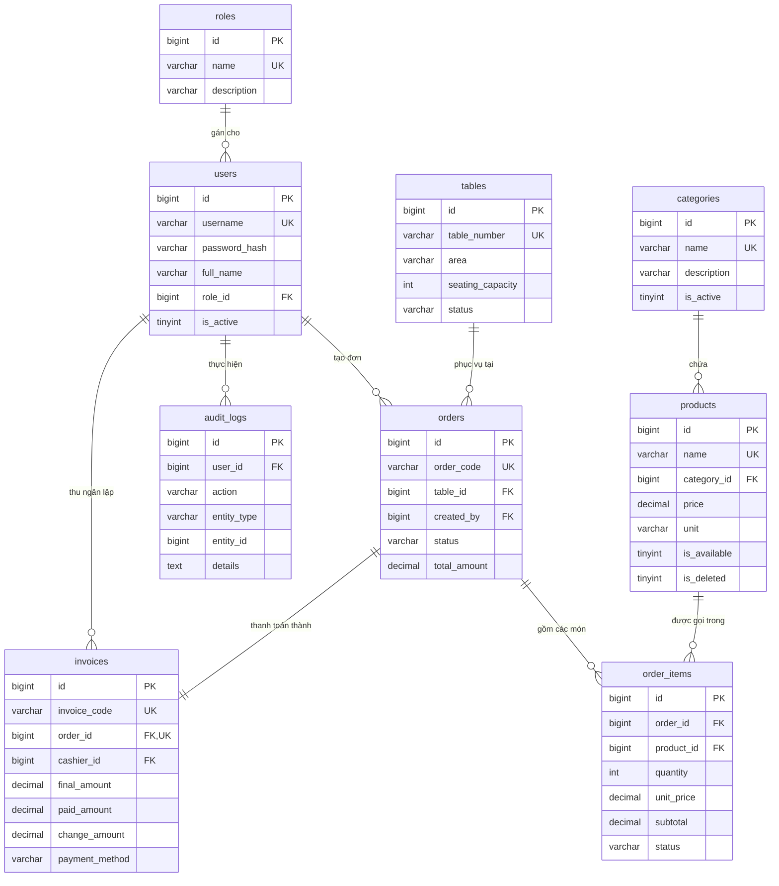

# Chương 3: Phân tích & Thiết kế Cơ sở dữ liệu

> **Người thực hiện:** B (@trungdunxg) — Data & Reports Lead  
> **Dự án:** Ứng dụng Desktop quản lý quán café TLU (BTL học phần Python 2026 — Đề tài 5)  
> **Mục tiêu:** Trình bày chi tiết quá trình phân tích nghiệp vụ, mô hình hóa dữ liệu (ERD), chuẩn hóa quan hệ (3NF), từ điển dữ liệu và các bất biến toàn vẹn số liệu của hệ thống CafeTLU.

---

## 3.1 Mở đầu

Cơ sở dữ liệu là trái tim của hệ thống phần mềm quản lý quán café TLU. Một hệ thống bán hàng thực tế đòi hỏi CSDL không chỉ đáp ứng các thao tác thêm, sửa, xóa thông thường (CRUD), mà quan trọng hơn phải bảo đảm tính toàn vẹn tài chính, chống thất thoát doanh thu, bảo toàn lịch sử giao dịch và phục vụ hiệu quả cho các báo cáo thống kê kinh doanh đa chiều.

Chương này trình bày toàn bộ quy trình thiết kế CSDL của CafeTLU: từ phân tích ca sử dụng (Use Case), xây dựng sơ đồ thực thể liên kết (ERD), thiết kế chi tiết 9 bảng dữ liệu, chứng minh tính đạt chuẩn 3NF, đến các giải pháp kỹ thuật cốt lõi như bảo toàn snapshot giá bán, xóa mềm, và đánh chỉ mục tối ưu hóa hiệu năng.

---

## 3.2 Phân tích yêu cầu nghiệp vụ & Ca sử dụng (Use Case)

Hệ thống quản lý quán café TLU phục vụ 3 nhóm đối tượng người dùng chính với các phân quyền và quy trình nghiệp vụ rõ ràng:

### 3.2.1 Phân hệ Quản trị viên (Admin)
- **Quản lý thực đơn:** Thêm món mới, phân loại theo danh mục, điều chỉnh giá bán niêm yết, bật/tắt trạng thái còn món, xóa mềm món không còn kinh doanh.
- **Quản lý nhân sự & tài khoản:** Tạo tài khoản nhân viên, phân quyền vai trò (`admin`, `staff`, `barista`), khóa/mở tài khoản.
- **Báo cáo kinh doanh:** Theo dõi doanh thu theo ngày/tháng, thống kê top món bán chạy, phân bổ doanh thu theo danh mục, xuất dữ liệu ra file Excel và PDF.
- **Giám sát hệ thống:** Xem nhật ký kiểm toán (Audit Logs) để truy vết các hành động nhạy cảm (đổi giá, xóa món, hủy đơn).

### 3.2.2 Phân hệ Phục vụ & Thu ngân (Staff)
- **Quản lý bàn:** Quan sát sơ đồ bàn theo khu vực (Tầng 1, Tầng 2, Ban công), nhận biết trạng thái bàn (Trống, Đang có khách, Đã đặt trước).
- **Gọi món tại bàn (Order):** Mở đơn cho bàn, thêm các món ăn/đồ uống khách chọn, ghi chú tùy biến (lượng đường, đá, yêu cầu riêng).
- **Thanh toán & Xuất hóa đơn:** Áp dụng giảm giá (nếu có), lựa chọn hình thức thanh toán (tiền mặt / chuyển khoản), tính tiền thừa và in hóa đơn cho khách.

### 3.2.3 Phân hệ Pha chế (Barista)
- **Tiếp nhận đơn pha chế:** Theo dõi danh sách các món cần chế biến theo thời gian thực.
- **Cập nhật tiến độ:** Chuyển trạng thái món từ `pending` (chờ làm) $\to$ `preparing` (đang pha) $\to$ `served` (đã phục vụ xong).

---

## 3.3 Mô hình Thực thể Quan hệ (ERD)

Hệ thống CSDL CafeTLU được chuẩn hóa thành **9 thực thể** độc lập, quan hệ chặt chẽ qua các khóa ngoại có ràng buộc tường minh.

### Phân tích bản chất các mối quan hệ:
1. **Quan hệ $1 - n$ giữa `categories` và `products`:** Một danh mục bao gồm nhiều sản phẩm; mỗi sản phẩm chỉ thuộc về duy nhất một danh mục xác định.
2. **Quan hệ $n - n$ giữa `orders` và `products` (thông qua bảng trung gian `order_items`):** Một đơn hàng gồm nhiều món khác nhau, và một món có thể xuất hiện trong nhiều đơn hàng độc lập. Bảng `order_items` đóng vai trò lưu vết chi tiết giao dịch.
3. **Quan hệ $1 - 1$ giữa `orders` và `invoices`:** Mỗi đơn hàng khi thanh toán chỉ sinh ra đúng một hóa đơn thanh toán duy nhất (`order_id` trong `invoices` có ràng buộc `UNIQUE`).
4. **Quan hệ $1 - n$ giữa `tables` và `orders`:** Mỗi bàn phục vụ nhiều lượt đơn theo dòng thời gian. Tại một thời điểm, chỉ có tối đa một đơn ở trạng thái `pending`.

---

## 3.4 Từ điển dữ liệu (Data Dictionary)

Toàn bộ CSDL được cài đặt trên hệ quản trị **MySQL 8.0**, Storage Engine **`InnoDB`**, bảng mã **`utf8mb4`** và collation **`utf8mb4_unicode_ci`** để hỗ trợ trọn vẹn tiếng Việt có dấu.

### 3.4.1 Bảng `roles` (Vai trò)
Quản lý các nhóm quyền truy cập trong hệ thống.
- `id`: BIGINT UNSIGNED, Khóa chính, Tự tăng.
- `name`: VARCHAR(50), Không rỗng, Duy nhất (`admin`, `staff`, `barista`).
- `description`: VARCHAR(255), Mô tả chi tiết quyền hạn.
- `created_at`, `updated_at`: DATETIME, Thời điểm tạo và cập nhật.

### 3.4.2 Bảng `users` (Tài khoản người dùng)
Lưu thông tin định danh nhân viên và quản lý.
- `id`: BIGINT UNSIGNED, Khóa chính, Tự tăng.
- `username`: VARCHAR(50), Không rỗng, Duy nhất (tên đăng nhập).
- `password_hash`: VARCHAR(255), Không rỗng, Băm an toàn bằng thuật toán `bcrypt` với cost factor 12.
- `full_name`: VARCHAR(100), Họ tên nhân viên.
- `role_id`: BIGINT UNSIGNED, Khóa ngoại tham chiếu `roles(id)`, `ON DELETE RESTRICT`.
- `is_active`: TINYINT(1), Mặc định 1 (1: đang làm việc, 0: khóa tài khoản).

### 3.4.3 Bảng `categories` (Danh mục)
Phân loại thực đơn quán café.
- `id`: BIGINT UNSIGNED, Khóa chính, Tự tăng.
- `name`: VARCHAR(100), Không rỗng, Duy nhất (Cà phê truyền thống, Trà trái cây,...).
- `description`: VARCHAR(255), Mô tả danh mục.
- `is_active`: TINYINT(1), Mặc định 1.

### 3.4.4 Bảng `products` (Thực đơn món ăn & đồ uống)
- `id`: BIGINT UNSIGNED, Khóa chính, Tự tăng.
- `name`: VARCHAR(150), Không rỗng, Duy nhất (Tên món ăn/đồ uống).
- `category_id`: BIGINT UNSIGNED, Khóa ngoại tham chiếu `categories(id)`, `ON DELETE RESTRICT`.
- `price`: **DECIMAL(12,0)**, Không rỗng, Giá bán niêm yết bằng VNĐ (**tuyệt đối không dùng FLOAT**).
- `unit`: VARCHAR(20), Mặc định 'ly' (ly, cốc, đĩa, phần, chiếc).
- `image_url`: VARCHAR(255), Đường dẫn file hình ảnh đại diện món.
- `is_available`: TINYINT(1), Mặc định 1 (1: còn nguyên liệu phục vụ, 0: tạm hết món).
- `is_deleted`: TINYINT(1), Mặc định 0 (Cờ xóa mềm).

### 3.4.5 Bảng `tables` (Bàn phục vụ)
- `id`: BIGINT UNSIGNED, Khóa chính, Tự tăng.
- `table_number`: VARCHAR(50), Không rỗng, Duy nhất (Bàn 01, Bàn 02,...).
- `area`: VARCHAR(50), Mặc định 'Tầng 1' (Tầng 1, Tầng 2, Ban công).
- `seating_capacity`: INT, Sức chứa chỗ ngồi tối đa.
- `status`: VARCHAR(20), Mặc định 'available' (`available`: bàn trống, `occupied`: đang có khách, `reserved`: đặt trước).
- `is_active`: TINYINT(1), Mặc định 1.

### 3.4.6 Bảng `orders` (Đơn hàng gọi món)
- `id`: BIGINT UNSIGNED, Khóa chính, Tự tăng.
- `order_code`: VARCHAR(50), Không rỗng, Duy nhất (Mã đơn: `ORD-YYYYMMDD-XXXX`).
- `table_id`: BIGINT UNSIGNED, Khóa ngoại tham chiếu `tables(id)`, `ON DELETE RESTRICT`.
- `created_by`: BIGINT UNSIGNED, Khóa ngoại tham chiếu `users(id)`, `ON DELETE RESTRICT`.
- `status`: VARCHAR(20), Mặc định 'pending' (`pending`: đang phục vụ, `completed`: đã thanh toán, `cancelled`: đã hủy).
- `total_amount`: DECIMAL(12,0), Mặc định 0, Tổng tiền các món trong đơn.
- `notes`: TEXT, Ghi chú chung của đơn.
- `is_deleted`: TINYINT(1), Mặc định 0.

### 3.4.7 Bảng `order_items` (Chi tiết món trong đơn)
- `id`: BIGINT UNSIGNED, Khóa chính, Tự tăng.
- `order_id`: BIGINT UNSIGNED, Khóa ngoại tham chiếu `orders(id)`, **`ON DELETE CASCADE`** (xóa đơn thì chi tiết món bị hủy theo).
- `product_id`: BIGINT UNSIGNED, Khóa ngoại tham chiếu `products(id)`, `ON DELETE RESTRICT`.
- `quantity`: INT, Mặc định 1, Số lượng món đặt ($\ge 1$).
- `unit_price`: **DECIMAL(12,0)**, Không rỗng, **Giá snapshot** tại thời điểm khách gọi món.
- `subtotal`: DECIMAL(12,0), Thành tiền = `quantity * unit_price`.
- `status`: VARCHAR(20), Mặc định 'pending' (`pending`, `preparing`, `served`, `cancelled`).
- `notes`: VARCHAR(255), Ghi chú riêng cho pha chế (ít đường, nhiều đá, uống nóng,...).

### 3.4.8 Bảng `invoices` (Hóa đơn thanh toán)
- `id`: BIGINT UNSIGNED, Khóa chính, Tự tăng.
- `invoice_code`: VARCHAR(50), Không rỗng, Duy nhất (Mã in bill: `INV-YYYYMMDD-XXXX`).
- `order_id`: BIGINT UNSIGNED, Không rỗng, Duy nhất, Khóa ngoại tham chiếu `orders(id)`, `ON DELETE RESTRICT`.
- `cashier_id`: BIGINT UNSIGNED, Khóa ngoại tham chiếu `users(id)` (thu ngân thực hiện).
- `subtotal_amount`: DECIMAL(12,0), Tiền hàng trước chiết khấu.
- `discount_amount`: DECIMAL(12,0), Mặc định 0, Số tiền giảm giá khuyến mãi.
- `final_amount`: DECIMAL(12,0), Tiền thực thu khách = `subtotal_amount - discount_amount`.
- `paid_amount`: DECIMAL(12,0), Số tiền khách hàng thanh toán.
- `change_amount`: DECIMAL(12,0), Tiền thừa trả lại cho khách.
- `payment_method`: VARCHAR(20), Mặc định 'cash' (`cash`: tiền mặt, `transfer`: chuyển khoản ngân hàng/VietQR, `card`: thẻ).
- `paid_at`: DATETIME, Thời điểm thanh toán thành công.

### 3.4.9 Bảng `audit_logs` (Nhật ký thao tác hệ thống)
- `id`: BIGINT UNSIGNED, Khóa chính, Tự tăng.
- `user_id`: BIGINT UNSIGNED, Có thể NULL, Khóa ngoại tham chiếu `users(id)`, **`ON DELETE SET NULL`**.
- `action`: VARCHAR(50), Hành động (`LOGIN`, `LOGOUT`, `CREATE_ORDER`, `CHECKOUT`, `UPDATE_PRICE`,...).
- `entity_type`: VARCHAR(50), Tên bảng bị tác động (`products`, `orders`, `invoices`,...).
- `entity_id`: BIGINT UNSIGNED, ID của bản ghi bị tác động.
- `details`: TEXT, Chuỗi JSON mô tả chi tiết trạng thái trước và sau khi thay đổi.
- `ip_address`: VARCHAR(45), Địa chỉ IP của máy trạm gọi API.

---

## 3.5 Các nguyên tắc thiết kế & Bất biến toàn vẹn dữ liệu

### 3.5.1 Chứng minh đạt dạng chuẩn 3NF
Mô hình CSDL CafeTLU được chứng minh đạt dạng chuẩn 3 (Third Normal Form - 3NF):
1. **Dạng chuẩn 1 (1NF):** Mọi thuộc tính trong tất cả các bảng đều chứa giá trị nguyên tố (atomic value). Không có thuộc tính lặp hay danh sách lồng trong một trường. Quan hệ nhiều - nhiều giữa `orders` và `products` được tách thành bảng riêng `order_items`.
2. **Dạng chuẩn 2 (2NF):** Đạt 1NF và mọi thuộc tính không khóa đều phụ thuộc hàm toàn bộ vào khóa chính. Với các bảng dùng khóa chính đơn (`id`), mọi thuộc tính hiển nhiên phụ thuộc hoàn toàn vào `id`.
3. **Dạng chuẩn 3 (3NF):** Đạt 2NF và không tồn tại phụ thuộc bắc cầu giữa các thuộc tính không khóa. Ví dụ: thông tin danh mục (`category_name`) không được lưu trực tiếp trong bảng `products` mà tách sang `categories`, thông tin vai trò người dùng tách sang `roles`.

### 3.5.2 Cơ chế Snapshot giá bán (Snapshot Pricing)
Trong kinh doanh quán café, giá niêm yết của món ăn/đồ uống có thể thay đổi theo thời giá hoặc chương trình khuyến mại. Nếu bảng `order_items` không lưu giá bán mà chỉ tham chiếu tới `products.price`:
$$\text{Nguy cơ:} \quad \text{Khi quản lý tăng giá món Bạc xỉu từ 25.000đ lên 28.000đ, toàn bộ hóa đơn đã bán tháng trước sẽ tự động bị tăng giá theo, làm sai lệch sổ sách kế toán!}$$
**Giải pháp:** Bảng `order_items` lưu trữ trường `unit_price` độc lập. Tại thời điểm thêm món vào đơn, giá niêm yết được chép (snapshot) vào `order_items.unit_price`. Sau thời điểm này, giá gốc tại bảng `products` có thay đổi thì các đơn cũ vẫn giữ nguyên giá trị lịch sử.

### 3.5.3 Chiến lược Xóa mềm (Soft Delete)
- Các thực thể quan trọng liên quan đến tài chính kế toán (`products`, `orders`) sử dụng cờ xóa mềm `is_deleted TINYINT(1) DEFAULT 0`.
- Khi người quản lý chọn xóa một món ăn khỏi menu, hệ thống chỉ cập nhật `is_deleted = 1`. Món ăn sẽ không hiển thị trên giao diện gọi món của nhân viên phục vụ, nhưng toàn bộ các đơn hàng và hóa đơn phát sinh trong quá khứ liên kết tới món đó vẫn hiển thị đầy đủ tên món, giá bán mà không bị vi phạm ràng buộc khóa ngoại (Foreign Key Constraint).

### 3.5.4 Quy định ràng buộc khóa ngoại (`ON DELETE`) có chủ đích
- `order_items` $\to$ `orders`: `ON DELETE CASCADE` — Nếu một đơn hàng bị hủy/xóa, các dòng chi tiết món của đơn đó mất đi tính độc lập nên được xóa đồng thời.
- `products` $\to$ `categories`: `ON DELETE RESTRICT` — Ngăn chặn tuyệt đối việc xóa nhầm một danh mục đồ uống khi vẫn còn các món ăn đang kinh doanh thuộc nhóm đó.
- `order_items` $\to$ `products`: `ON DELETE RESTRICT` — Bảo vệ tính toàn vẹn của sản phẩm đã từng phát sinh giao dịch bán hàng.
- `audit_logs` $\to$ `users`: `ON DELETE SET NULL` — Khi một nhân viên nghỉ việc và bị xóa tài khoản, toàn bộ nhật ký thao tác lịch sử do nhân viên đó thực hiện vẫn phải được bảo lưu để phục vụ điều tra, chỉ đặt trường `user_id = NULL`.

---

## 3.6 Tối ưu hóa truy vấn & Đánh chỉ mục (Index Strategy)

Để hệ thống vận hành mượt mà khi dữ liệu tăng trưởng lên hàng chục nghìn đơn hàng, các chỉ mục (Indexes) được thiết kế có chọn lọc theo các tần suất truy vấn thực tế:

| Bảng | Tên Index | Các cột đánh chỉ mục | Mục đích tối ưu |
|---|---|---|---|
| `products` | `uq_products_name` | `name` | Ràng buộc duy nhất tên món + tìm kiếm món tức thời |
| `products` | `idx_products_category_id` | `category_id` | Tăng tốc độ lọc thực đơn theo từng danh mục |
| `orders` | `idx_orders_created_at` | `created_at` | Tối ưu hóa truy vấn báo cáo doanh thu theo khoảng thời gian |
| `orders` | `idx_orders_table_id` | `table_id` | Tìm nhanh đơn hàng đang mở của một bàn cụ thể |
| `order_items` | `idx_order_items_product_id` | `product_id` | Tối ưu câu lệnh `GROUP BY` thống kê top món bán chạy |
| `invoices` | `idx_invoices_paid_at` | `paid_at` | Lọc sổ cái hóa đơn theo ngày/tháng thanh toán |

---

## 3.7 Tổng kết

CSDL CafeTLU được thiết kế chặt chẽ, chuẩn mực, bám sát các yêu cầu khắt khe của một phần mềm bán hàng thực tế. Bản thiết kế giải quyết triệt để các bài toán khó về toàn vẹn dữ liệu: tránh sai số nhị phân bằng `DECIMAL(12,0)`, bảo toàn giá bán lịch sử bằng snapshot pricing, bảo vệ dữ liệu bằng xóa mềm và tối ưu hóa hiệu năng thông qua chiến lược đánh chỉ mục thông minh.

Đây là cơ sở vững chắc để tầng Backend (FastAPI / SQLAlchemy) triển khai các model và tầng Giao diện (PySide6) vận hành các chức năng quản lý, bán hàng và báo cáo một cách ổn định, tin cậy.
